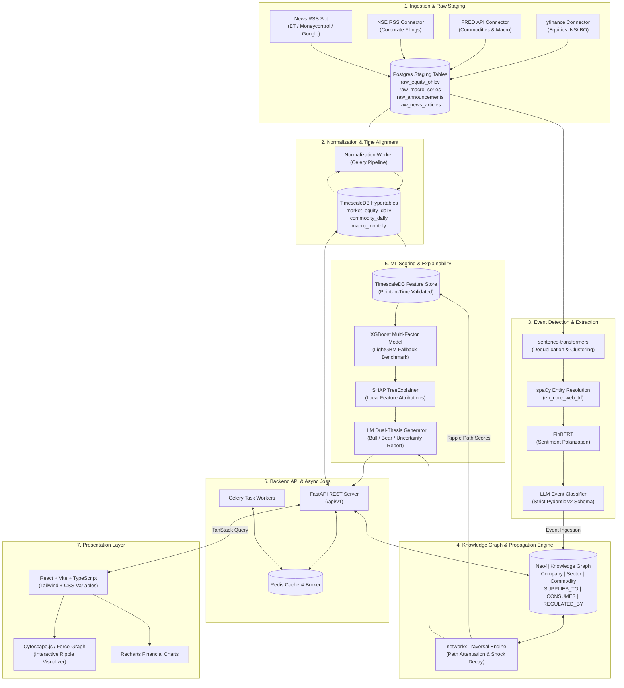

# System Architecture & Technical Specification
**Project:** Explainable AI Market Ripple Engine  
**Document Version:** 1.0.0  
**Phase:** 2 — Architecture & Design  
**Status:** Approved for Review  

---

## 1. High-Level System Architecture

The Market Ripple Engine is designed as a decoupled, event-driven, hybrid symbolic-statistical system. It processes raw macroeconomic indicators, market time series, and corporate announcements, transforms unstructured information into typed graph events, simulates multi-hop shock propagation through supply and regulatory graphs, scores equities with gradient-boosted trees, and generates structured, balance-constrained explanations.



---

## 2. Mathematical Propagation & Attenuation Model

To prevent arbitrary or explosive shock values across distant relationships, the graph traversal engine evaluates multi-hop transmission using **Elasticity Decay along Directed Paths**.

### 2.1 Path Shock Formulation
For a detected event $E$ initiating at source node $u_0$ with magnitude $S_E \in [-1.0, 1.0]$ and confidence $C_E \in [0.0, 1.0]$, the transmitted impact to target node $v$ along path $P = (u_0, u_1, \dots, u_k = v)$ of hop length $k$ is given by:

$$\text{Impact}(P, v) = S_E \cdot C_E \cdot \left( \prod_{i=0}^{k-1} w(u_i, u_{i+1}) \right) \cdot \alpha^k$$

where:
- $w(u_i, u_{i+1}) \in [0.0, 1.0]$ is the normalized relationship `strength` (e.g., fraction of cost of goods sold, revenue dependency, or historical price co-elasticity).
- $\alpha \in (0.0, 1.0]$ is the **Hop Attenuation Factor**.
- $k \in \{1, 2, 3\}$ is the path hop distance.

When multiple distinct paths connect $u_0$ to $v$, the aggregated ripple score $\mathcal{R}(v)$ is computed as the bounded sum:

$$\mathcal{R}(v) = \tanh\left( \sum_{P \in \text{Paths}(u_0, v)} \text{Impact}(P, v) \right) \in [-1.0, 1.0]$$

### 2.2 Hop Attenuation Factor ($\alpha$) Optimization & Testing Protocol
Rather than hardcoding $\alpha$ arbitrarily:
1. **Initial Calibration:** Set $\alpha_0 = 0.65$ based on empirical supply chain transmission literature (shocks typically lose 30–40% per tier without contract escalation).
2. **Empirical Optimization Strategy:**
   - Grid search $\alpha \in [0.40, 0.90]$ in steps of $0.05$ on the historical validation set (2021–2023).
   - Evaluate against 7-day cumulative abnormal returns (CAR) of 2-hop and 3-hop companies following major historical commodity shocks (e.g., 2022 Coking Coal spike, 2022 Brent crude surge).
   - Objective function minimizes mean squared prediction error of the downstream regression model while penalizing $\alpha$ values that inflate noise on $k \ge 3$ paths.
3. **Automated Testing Assertion:** Unit tests under `tests/test_graph_propagation.py` assert that:
   $$\forall k_1 < k_2 \implies |\text{Impact}(P_{k_2})| < |\text{Impact}(P_{k_1})| \quad (\text{monotonic distance decay under identical weights})$$

---

## 3. Monorepo Directory Layout

The workspace is organized as a clean, production-grade monorepo isolating backend, ML, frontend, infrastructure, and offline testing fixtures:

```
v:/vik_project/
├── .antigravity/
│   └── rules.md                       # Verbatim project rules & constraints
├── .agents/
│   └── rules/
│       └── market_ripple_engine_rules.md
├── docs/
│   ├── feasibility_critique.md        # Phase 1: Feasibility and risk audit
│   ├── architecture.md                # Phase 2: Architecture & token spec
│   ├── schema.md                      # Phase 2: Relational & Graph schema
│   └── presentation.md                # Phase 4: Final academic writeup
├── infra/
│   ├── docker-compose.yml             # Postgres/TimescaleDB, Neo4j, Redis, API, Worker, Nginx
│   ├── nginx.conf                     # Reverse proxy routing /api to FastAPI and / to Vite
│   ├── Dockerfile.backend             # Multi-stage Python 3.11 container
│   ├── Dockerfile.frontend            # Multi-stage Node/Vite build container
│   └── .env.example                   # Sane default environment configuration
├── backend/
│   ├── app/
│   │   ├── main.py                    # FastAPI application initialization & middleware
│   │   ├── core/
│   │   │   ├── config.py              # Pydantic Settings (DB URLs, API keys, Redis config)
│   │   │   └── security.py            # CORS, rate limiting, and request validation
│   │   ├── api/
│   │   │   └── v1/
│   │   │       ├── endpoints/
│   │   │       │   ├── events.py      # Event listing, details, and on-demand detection
│   │   │       │   ├── ripple.py      # Graph traversal subgraphs and path scoring
│   │   │       │   ├── companies.py   # Multi-factor scorecards and price series
│   │   │       │   └── predictions.py # Prediction tracking and backtest triggers
│   │   │       └── router.py          # Unified APIRouter mounting v1 endpoints
│   │   ├── db/
│   │   │   ├── session.py             # SQLAlchemy 2.0 async engine & sessionmaker
│   │   │   ├── base.py                # DeclarativeBase with common timestamp mixins
│   │   │   └── neo4j_client.py        # Neo4j driver connection pool & query helpers
│   │   ├── models/                    # SQLAlchemy ORM models (tables matching schema.md)
│   │   │   ├── raw_staging.py
│   │   │   ├── market_data.py
│   │   │   ├── event_models.py
│   │   │   └── prediction_models.py
│   │   ├── schemas/                   # Pydantic v2 validation and response models
│   │   │   ├── event_schemas.py
│   │   │   ├── graph_schemas.py
│   │   │   ├── company_schemas.py
│   │   │   └── prediction_schemas.py
│   │   ├── tasks/                     # Celery background tasks
│   │   │   ├── celery_app.py          # Celery worker & beat scheduler setup
│   │   │   ├── ingestion_tasks.py     # Scheduled RSS/FRED/yfinance fetchers
│   │   │   └── scoring_tasks.py       # Forward prediction evaluation jobs (1d/7d/30d)
│   │   └── services/                  # Business logic services
│   │       ├── ingestion/             # Source connectors (yfinance, FRED, RSS)
│   │       └── graph_service.py       # Neo4j Cypher querying & networkx bridge
│   ├── alembic/                       # Database migrations
│   │   ├── env.py
│   │   ├── script.py.mako
│   │   └── versions/
│   └── requirements.txt               # Backend Python dependencies
├── ml/
│   ├── nlp/
│   │   ├── event_detector.py          # EventDetector interface (spaCy + Pydantic LLM)
│   │   ├── entity_linker.py           # Exact and fuzzy entity resolution to node IDs
│   │   ├── sentiment.py               # FinBERT financial sentiment polarization
│   │   └── deduplication.py           # sentence-transformers embeddings & clustering
│   ├── graph/
│   │   ├── propagation.py             # Multi-hop shock calculation & alpha-decay
│   │   └── graph_analytics.py         # networkx centrality, shortest paths, cutsets
│   ├── scoring/
│   │   ├── feature_builder.py         # Point-in-time feature extraction pipeline
│   │   ├── split_utils.py             # Purged & embargoed chronological splitters
│   │   ├── model_trainer.py           # XGBoost training & LightGBM benchmark comparison
│   │   └── explainers.py              # SHAP TreeExplainer & feature attribution extractors
│   ├── explanation/
│   │   └── thesis_generator.py        # Pydantic-constrained Bull/Bear/Uncertainty generator
│   ├── backtesting/
│   │   ├── engine.py                  # Point-in-time backtest replay harness
│   │   └── metrics.py                 # Accuracy, MAE, RMSE, Brier score, Calibration
│   └── requirements-ml.txt            # ML/NLP Python dependencies
├── frontend/
│   ├── src/
│   │   ├── assets/                    # Static icons and logos
│   │   ├── components/
│   │   │   ├── common/                # ThemeToggle, StatCard, Badge, DataTable
│   │   │   ├── dashboard/             # MarketOverview, SectorHeatmap, RecentEventsFeed
│   │   │   ├── ripple/                # ForceGraphCanvas, CytoscapeViewer, PathBreadcrumb
│   │   │   ├── company/               # CompanyScorecard, ShapBarChart, DualThesisCard
│   │   │   └── predictions/           # PredictionTimeline, CalibrationScatter, BacktestModal
│   │   ├── context/
│   │   │   └── ThemeContext.tsx       # Persisted data-theme provider (localStorage + system)
│   │   ├── hooks/                     # Custom hooks (useEvents, useRippleGraph, useCompany)
│   │   ├── lib/                       # API client (Axios/Fetch), utils, number formatters
│   │   ├── pages/                     # Routed views (Dashboard, Events, Ripple, Company, History)
│   │   ├── styles/
│   │   │   └── globals.css            # Token definitions (:root[data-theme="dark"|"light"])
│   │   ├── types/                     # TypeScript interfaces matching backend Pydantic models
│   │   ├── App.tsx                    # React router & query client setup
│   │   └── main.tsx                   # Entry point
│   ├── package.json
│   ├── tsconfig.json
│   ├── vite.config.ts
│   └── tailwind.config.ts
├── tests/
│   ├── conftest.py                    # Pytest fixtures and mock DB sessions
│   ├── fixtures/                      # Offline recorded test payloads (NO live API calls in CI)
│   │   ├── yfinance_sample.json
│   │   ├── fred_sample.json
│   │   ├── nse_announcements_sample.xml
│   │   ├── news_rss_sample.xml
│   │   └── labeled_events.json
│   ├── backend/                       # FastAPI endpoint & DB unit/integration tests
│   ├── ml/                            # Split integrity, XGBoost, SHAP, and NLP unit tests
│   └── frontend/                      # Vitest component & render tests
└── .github/
    └── workflows/
        └── ci.yml                     # Linting (Ruff/ESLint), Typecheck (mypy/tsc), Pytest, Vitest
```

---

## 4. UI Design System & Theme Specification

Per the locked project rules, the user interface follows a dense, distraction-free financial terminal aesthetic. Theming is implemented strictly via CSS variables bound to `data-theme` on the root HTML element.

### 4.1 Token Definitions & Contrast Audit

```css
/* ==========================================================================
   CSS Variable Token System — Market Ripple Engine
   Defined in: frontend/src/styles/globals.css
   ========================================================================== */

:root,
:root[data-theme="dark"] {
  /* Surface & Base (Charcoal Dark Palette) */
  --bg: #0B0E14;              /* Deep terminal charcoal */
  --surface: #121722;         /* Primary card container */
  --surface-raised: #1A2232;  /* Hovered cards, dropdowns, modal layers */
  --surface-inset: #07090D;   /* Chart canvas background, code blocks */
  --border: #232D42;          /* Subtle structural grid lines */
  --border-active: #384869;   /* Focused input, selected node boundary */

  /* Text & Hierarchy (WCAG AAA/AA Compliant) */
  --text-primary: #E8ECF2;    /* Contrast ratio 14.2:1 against --bg */
  --text-muted: #8896AB;      /* Contrast ratio 5.1:1 against --bg */
  --text-dim: #546277;        /* De-emphasized timestamps & table headers */

  /* Semantic Financial Accents */
  --accent-positive: #10B981; /* Emerald 500 (Bullish, Gain, Inflow) */
  --accent-positive-bg: rgba(16, 185, 129, 0.12);
  --accent-negative: #EF4444; /* Red 500 (Bearish, Loss, Shock) */
  --accent-negative-bg: rgba(239, 68, 68, 0.12);
  --accent-warning: #F59E0B;  /* Amber 500 (Supply Risk, Moderate Impact) */
  --accent-warning-bg: rgba(245, 158, 11, 0.12);
  --accent-info: #3B82F6;     /* Blue 500 (Graph Nodes, Inferred Edges) */
  --accent-info-bg: rgba(59, 130, 246, 0.12);

  /* Graph Node Specific Palettes */
  --node-company: #38BDF8;    /* Sky Blue */
  --node-commodity: #F59E0B;  /* Amber */
  --node-sector: #A855F7;     /* Purple */
  --node-event: #EF4444;      /* Red */

  /* Font Families */
  --font-ui: "Inter", -apple-system, BlinkMacSystemFont, "Segoe UI", Roboto, sans-serif;
  --font-mono: "JetBrains Mono", "SF Mono", Consolas, Menlo, monospace;
}

:root[data-theme="light"] {
  /* Surface & Base (Warm Off-White Palette) */
  --bg: #F7F8FA;              /* Warm off-white (not eye-straining pure white) */
  --surface: #FFFFFF;         /* Crisp white card surface */
  --surface-raised: #EDF0F5;  /* Subtle raised element / table hover */
  --surface-inset: #ECEFF4;   /* Inset search fields & code snippets */
  --border: #D2D8E2;          /* Clean structural divider */
  --border-active: #94A3B8;   /* Active border boundary */

  /* Text & Hierarchy (WCAG AAA/AA Compliant) */
  --text-primary: #0F172A;    /* Slate 900 (Contrast 15.8:1 against --bg) */
  --text-muted: #526075;      /* Slate 600 (Contrast 6.2:1 against --bg) */
  --text-dim: #8291A5;        /* Secondary timestamp text */

  /* Semantic Financial Accents (Adjusted for Light Surface Contrast) */
  --accent-positive: #059669; /* Emerald 600 */
  --accent-positive-bg: rgba(5, 150, 105, 0.10);
  --accent-negative: #DC2626; /* Red 600 */
  --accent-negative-bg: rgba(220, 38, 38, 0.10);
  --accent-warning: #D97706;  /* Amber 600 */
  --accent-warning-bg: rgba(217, 119, 6, 0.10);
  --accent-info: #2563EB;     /* Blue 600 */
  --accent-info-bg: rgba(37, 99, 235, 0.10);

  /* Graph Node Specific Palettes */
  --node-company: #0284C7;    /* Deep Sky */
  --node-commodity: #D97706;  /* Warm Amber */
  --node-sector: #9333EA;     /* Deep Purple */
  --node-event: #DC2626;      /* Deep Red */

  /* Font Families */
  --font-ui: "Inter", -apple-system, BlinkMacSystemFont, "Segoe UI", Roboto, sans-serif;
  --font-mono: "JetBrains Mono", "SF Mono", Consolas, Menlo, monospace;
}
```

### 4.2 Theme Management Implementation Pattern
The frontend avoids framework lock-in by implementing a lightweight `ThemeContext` providing:
- Local storage persistence under key `market_ripple_theme`.
- Automatic system fallback listening to `(prefers-color-scheme: dark)`.
- Synchronous direct attribute injection on `document.documentElement.setAttribute("data-theme", theme)` to prevent Flash of Unstyled Theme (FOUT).

---

## 5. Complete REST API Surface

All API endpoints are prefixed with `/api/v1` and return strict JSON payloads conforming to standard HTTP status codes (`200 OK`, `201 Created`, `400 Bad Request`, `404 Not Found`, `422 Unprocessable Entity`, `500 Internal Error`).

### 5.1 Events API

#### `GET /api/v1/events`
Fetch historical or live detected market events with multi-dimensional filtering.
* **Query Parameters:**
  * `sector` (optional, string): e.g., `Automotive`
  * `archetype` (optional, enum): `COMMODITY_SHOCK`, `POLICY_TAX_CHANGE`, `SUPPLY_DISRUPTION`, `MACRO_RATE_SHIFT`
  * `min_significance` (optional, float): `0.0` to `1.0`
  * `start_date` (optional, ISO 8601): `2023-01-01`
  * `end_date` (optional, ISO 8601): `2023-12-31`
  * `limit` (default: 50, max: 200)
  * `offset` (default: 0)
* **Response `200 OK`:**
```json
{
  "total": 142,
  "limit": 50,
  "offset": 0,
  "items": [
    {
      "id": "evt_c8f2a1b9",
      "timestamp": "2023-03-15T09:30:00Z",
      "title": "Directorate General of Foreign Trade hikes Steel Export Duty by 15%",
      "archetype": "POLICY_TAX_CHANGE",
      "source_headline": "India imposes export tariff on finished steel products to curb domestic inflation",
      "source_url": "https://economictimes.indiatimes.com/...",
      "origin_node_id": "SEC_STEEL",
      "origin_node_type": "Sector",
      "magnitude": -0.75,
      "confidence": 0.92,
      "sentiment_score": -0.68,
      "touched_sectors": ["Steel/Metals", "Automotive"],
      "touched_commodities": ["Hot Rolled Steel Coil"]
    }
  ]
}
```

#### `GET /api/v1/events/{id}`
Retrieve complete entity linkage and impact summary for a single event.
* **Response `200 OK`:**
```json
{
  "id": "evt_c8f2a1b9",
  "timestamp": "2023-03-15T09:30:00Z",
  "title": "Directorate General of Foreign Trade hikes Steel Export Duty by 15%",
  "raw_text": "Full text of the notification...",
  "archetype": "POLICY_TAX_CHANGE",
  "magnitude": -0.75,
  "confidence": 0.92,
  "extracted_entities": [
    {"name": "Steel Export Duty", "entity_type": "POLICY", "node_id": "SEC_STEEL"},
    {"name": "Tata Steel", "entity_type": "COMPANY", "node_id": "TATASTEEL.NS"},
    {"name": "JSW Steel", "entity_type": "COMPANY", "node_id": "JSWSTEEL.NS"}
  ],
  "downstream_impact_count": 8,
  "top_impacted_ticker": "TATASTEEL.NS"
}
```

#### `POST /api/v1/events/detect`
Ad-hoc NLP extraction and classification endpoint for arbitrary user-submitted market text.
* **Request Body:**
```json
{
  "text": "Severe drought in Western Australia halts coking coal rail operations to Port Hedland for 3 weeks.",
  "publish_timestamp": "2023-04-10T14:00:00Z",
  "source_name": "Reuters Supply Chain Feed"
}
```
* **Response `200 OK`:**
```json
{
  "detected_event": {
    "archetype": "SUPPLY_DISRUPTION",
    "magnitude": -0.85,
    "confidence": 0.89,
    "primary_commodity": "COMM_COKING_COAL",
    "primary_sector": "SEC_STEEL",
    "reasoning": "Unplanned logistical disruption directly impacts metallurgical coking coal export volume.",
    "spacy_entities": [
      {"text": "Western Australia", "label": "GPE"},
      {"text": "coking coal", "label": "PRODUCT"},
      {"text": "Port Hedland", "label": "FAC"}
    ]
  }
}
```

---

### 5.2 Ripple & Graph API

#### `GET /api/v1/ripple/graph`
Traverse and extract the transmission subgraph and shock attenuation paths initiated by an event.
* **Query Parameters:**
  * `event_id` (required, string): `evt_c8f2a1b9`
  * `max_hops` (default: 3, range: 1–4)
  * `min_path_strength` (default: 0.15)
* **Response `200 OK`:**
```json
{
  "event_id": "evt_c8f2a1b9",
  "hop_decay_alpha": 0.65,
  "nodes": [
    {"id": "SEC_STEEL", "label": "Steel/Metals Sector", "type": "Sector", "initial_shock": -0.75},
    {"id": "TATASTEEL.NS", "label": "Tata Steel Ltd", "type": "Company", "sector": "Steel/Metals"},
    {"id": "TATAMOTORS.NS", "label": "Tata Motors Ltd", "type": "Company", "sector": "Automotive"},
    {"id": "COMM_HRC_STEEL", "label": "Hot Rolled Steel Coil", "type": "Commodity"}
  ],
  "edges": [
    {
      "source": "SEC_STEEL",
      "target": "TATASTEEL.NS",
      "relation": "REGULATED_BY",
      "strength": 0.90,
      "source_tag": "manual_seed",
      "hop": 1,
      "path_shock": -0.675
    },
    {
      "source": "TATASTEEL.NS",
      "target": "TATAMOTORS.NS",
      "relation": "SUPPLIES_TO",
      "strength": 0.70,
      "source_tag": "manual_seed",
      "hop": 2,
      "path_shock": 0.198
    }
  ],
  "impact_summary": [
    {
      "ticker": "TATASTEEL.NS",
      "net_ripple_score": -0.675,
      "hop_distance": 1,
      "path_description": "Export Tariff Hike -> Steel Sector -> Tata Steel (Margin Contraction on Exports)"
    },
    {
      "ticker": "TATAMOTORS.NS",
      "net_ripple_score": 0.198,
      "hop_distance": 2,
      "path_description": "Export Tariff Hike -> Tata Steel -> Domestic Steel Price Softening -> Tata Motors (Input Cost Relief)"
    }
  ]
}
```

---

### 5.3 Company Analysis & Explainability API

#### `GET /api/v1/companies/{ticker}/analysis`
Retrieve the latest multi-factor scoring, SHAP feature attributions, and structured dual-thesis explanation.
* **Query Parameters:**
  * `event_id` (optional, string): Filter attribution relative to a specific event shock.
* **Response `200 OK`:**
```json
{
  "ticker": "TATAMOTORS.NS",
  "company_name": "Tata Motors Limited",
  "sector": "Automotive",
  "score_timestamp": "2023-03-15T10:00:00Z",
  "prediction": {
    "direction": "BULLISH",
    "impact_score": 0.38,
    "confidence": 0.81,
    "horizon_days": 7,
    "risk_label": "MODERATE"
  },
  "shap_attributions": [
    {"feature": "upstream_commodity_steel_ripple", "value": -0.45, "shap_contribution": 0.28},
    {"feature": "crude_oil_30d_momentum", "value": 0.05, "shap_contribution": -0.09},
    {"feature": "operating_margin_ttm", "value": 0.062, "shap_contribution": 0.11},
    {"feature": "finbert_news_sentiment_7d", "value": 0.22, "shap_contribution": 0.08}
  ],
  "structured_report": {
    "summary": "Tata Motors demonstrates net positive 7-day elasticity following domestic steel export tariff hikes due to projected input cost compression across sheet metal procurement.",
    "bull_case": "Domestic steel oversupply exerts downward pressure on hot-rolled coil prices, leading to a 120-180 bps gross margin expansion in commercial vehicle manufacturing over the next quarter.",
    "bear_case": "Higher crude oil prices and potential interest rate hikes could suppress retail automotive demand, offsetting raw material input cost savings.",
    "uncertainty_analysis": "Transmission lag between spot steel price declines and negotiated quarterly OEM supply contracts may delay margin realization beyond the 7-day horizon."
  }
}
```

#### `GET /api/v1/companies/{ticker}/timeseries`
Fetch chronological price action, rolling sentiment index, and annotated event markers.
* **Query Parameters:**
  * `start_date` (ISO 8601): `2023-01-01`
  * `end_date` (ISO 8601): `2023-06-30`
* **Response `200 OK`:**
```json
{
  "ticker": "TATAMOTORS.NS",
  "points": [
    {
      "date": "2023-03-15",
      "open": 420.50,
      "high": 432.80,
      "low": 418.10,
      "close": 429.30,
      "volume": 12450000,
      "rolling_sentiment": 0.35,
      "associated_events": ["evt_c8f2a1b9"]
    }
  ]
}
```

---

### 5.4 Prediction History & Backtesting API

#### `GET /api/v1/predictions`
List historical predictions with their recorded point-in-time state, actual verified outcomes, and Brier calibration scores.
* **Query Parameters:**
  * `horizon` (optional, int): `1`, `7`, or `30`
  * `status` (optional, string): `PENDING_EVALUATION` or `EVALUATED`
  * `ticker` (optional, string): e.g., `TATASTEEL.NS`
* **Response `200 OK`:**
```json
{
  "total": 312,
  "accuracy_summary": {
    "horizon_1d_directional_acc": 0.612,
    "horizon_7d_directional_acc": 0.648,
    "horizon_30d_directional_acc": 0.589,
    "brier_score_7d": 0.184
  },
  "predictions": [
    {
      "id": "pred_90a42f",
      "created_at": "2023-03-15T10:00:00Z",
      "ticker": "TATASTEEL.NS",
      "event_id": "evt_c8f2a1b9",
      "horizon_days": 7,
      "predicted_direction": "BEARISH",
      "predicted_score": -0.65,
      "confidence": 0.88,
      "actual_price_at_prediction": 118.50,
      "actual_price_at_horizon": 111.20,
      "actual_return_pct": -6.16,
      "is_correct": true,
      "evaluated_at": "2023-03-22T10:00:00Z"
    }
  ]
}
```

#### `POST /api/v1/predictions/backtest/run`
Trigger an asynchronous historical event replay backtest job with strict point-in-time data isolation.
* **Request Body:**
```json
{
  "train_start_date": "2020-01-01",
  "train_end_date": "2022-06-30",
  "val_start_date": "2022-07-01",
  "val_end_date": "2022-12-31",
  "test_start_date": "2023-01-01",
  "test_end_date": "2023-12-31",
  "embargo_window_days": 7,
  "model_type": "XGBOOST"
}
```
* **Response `202 Accepted`:**
```json
{
  "job_id": "job_bt_8921df",
  "status": "QUEUED",
  "estimated_seconds": 45
}
```
